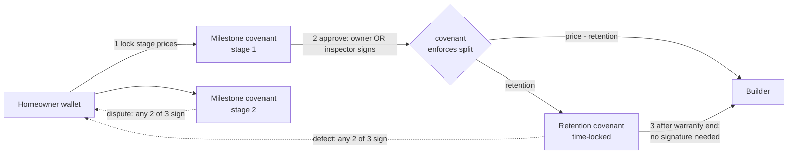
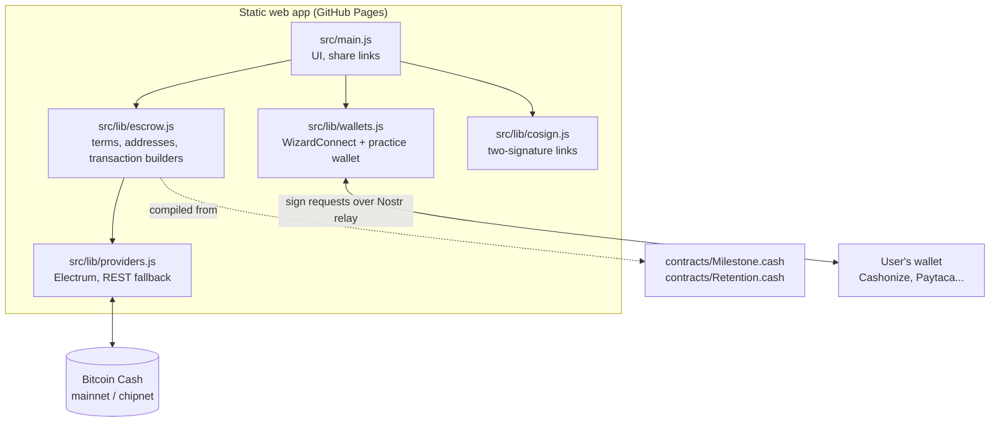

# Veridom Escrow

**Pay your builder stage by stage. The chain holds the money, not a promise.**

Construction escrow on Bitcoin Cash, built for BCH BLAZE 2026 (Mainnet Track) as a new
module of [Veridom](https://veridom.space), a house-building control app for private homebuilders.

- A homeowner locks the price of each building stage in its own CashScript covenant.
- When the homeowner (or an independent inspector) approves a stage, the covenant itself pays the
  builder and sets a retention aside. Nobody can redirect that money.
- The retention sits in a second covenant until the warranty end date. After that date anyone can
  trigger the payout, and it can only go to the builder.
- Works with BCH or with a CashToken stablecoin (ParyonUSD on mainnet).
- No server and no custody: a static web page, your own wallet through WizardConnect, and the chain.

## Why

Building a house means paying tens of thousands in advance to a company you met a few weeks ago.
The usual tools are a bank guarantee or a notary escrow account: slow, paperwork-heavy and out of
reach for a bathroom refit or a garden studio. The builder has the opposite fear: the client who
stops answering when the last invoice is due, or who never releases the warranty holdback.

A retention ("Haftrücklass" in Austrian building contracts) is standard practice, but it is
normally just money the client keeps. Here it is locked by a rule both sides can read.

## How it works





**The link is the agreement.** All terms (three public keys, stages, prices, retention, warranty
date, currency) are encoded in the URL after `#`. Their sha256 is a constructor argument of every
covenant, so anyone who opens the link recomputes the same vault addresses. A page cannot show a
fake escrow, and changing one number moves every address.

### The two covenants

| Contract | Spend path | Who | What the script enforces |
|---|---|---|---|
| `Milestone.cash` | `release` | homeowner **or** inspector | output 0 pays the builder exactly `price - retention`; output 1 pays the retention vault exactly `retention`; same token category; for stablecoins the token amounts are split |
| | `cosign` | any 2 of 3 | free spend (refund, partial settlement, replacing the builder) |
| `Retention.cash` | `claim` | anyone | `tx.time >= warrantyEnd`; each vault input is paid in full (BCH and tokens) to the builder at the same output index |
| | `cosign` | any 2 of 3 | free spend (defect remedy, early settlement) |

One UTXO per milestone means there is no shared state to contend for: stages can be approved in
any order and in parallel, and the stablecoin path needs no extra state NFT.

## Proof on chain (chipnet)

Full life cycle run by `scripts/chipnet-demo.mjs`; all ids are in [`proofs/chipnet.json`](proofs/chipnet.json).

| Step | Transaction |
|---|---|
| Mint tUSD test stablecoin | [cd35c42e…](https://chipnet.imaginary.cash/tx/cd35c42e9733910cc4a4f77c3dd1663f1f9db9fa80a04c294b8b5505ea2bf488) |
| BCH escrow: lock 2 stages | [ab27e29b…](https://chipnet.imaginary.cash/tx/ab27e29bb7df6422e9052fefd2ea63655d29bcc10d95bc627db106b950e7686c) |
| Stage 1 approved by homeowner (2400 to builder, 600 to vault) | [8fe57c11…](https://chipnet.imaginary.cash/tx/8fe57c11b20351da6418b9939eaf812d41cc605fa545e41a852d5606831e5336) |
| Stage 2 certified by inspector | [3bdb9db2…](https://chipnet.imaginary.cash/tx/3bdb9db2a7082bfcda96775b502bf06d1f1a1d45f933c4922ee6f2451676de73) |
| Stablecoin escrow: lock 1500.00 + 2500.00 tUSD | [5d52e01e…](https://chipnet.imaginary.cash/tx/5d52e01e893bbd55c3ba7da2483c04f8172f40b50d60bf748e5f2cb6fa200ebb) |
| Stage approved: 1350.00 tUSD to builder, 150.00 to vault | [3e04a20d…](https://chipnet.imaginary.cash/tx/3e04a20d54ae13499473afba1baff90c129dc7ebb11526fba53c0095b783b35f) |
| Dispute path: homeowner + inspector refund a stage | [1c670637…](https://chipnet.imaginary.cash/tx/1c670637310b2f55a24d81485173a8a4999b873b7c883409effe2178d3a87a49) |
| Early retention claim, before the warranty date | refused by the network (time lock), recorded in `proofs/chipnet.json` |
| Retention claim after the warranty date, BCH | [6086ec21…](https://chipnet.imaginary.cash/tx/6086ec2186aaba15d27841b2812c1d9c666d6f43e9dffeae3476a5ab18e1e12c) |
| Retention claim after the warranty date, tUSD | [0d34f3ad…](https://chipnet.imaginary.cash/tx/0d34f3adcd5aa8e9f95c4264f009747cff707696a4f96847b65faa3961b85d09) |

WizardConnect signing was checked end to end on chipnet with a headless wallet that follows the
hdwalletv1 rules, over the public relay ([`proofs/wizardconnect-e2e.json`](proofs/wizardconnect-e2e.json)):
[fund](https://chipnet.imaginary.cash/tx/862639a4738965a973a0390ed5c9248f5b17d06d84347986880e27a8024c6066),
[approve](https://chipnet.imaginary.cash/tx/c87b3aac0d6af16886fe1edd701d75b9a15b9425e19dc837539883726fb57494),
[two-signature refund](https://chipnet.imaginary.cash/tx/9133d23ebe139f2fc347fc63a18622400cad08fc0da0b3bbd442a92c85feace0).

Two-signature actions across two devices ([`proofs/cosign-e2e.json`](proofs/cosign-e2e.json)): the first
party signs and shares a link, the second party's app re-checks the transaction against the chain
and co-signs.
[wallet signs first, a second key co-signs](https://chipnet.imaginary.cash/tx/b114db1aba62d02dbce4d74e13ecf4883dd31041982021d9f66404799dc8393d),
[a key signs first, the wallet co-signs](https://chipnet.imaginary.cash/tx/0c00c7dad184ce6549c41f93ec20ccb3b70488c7ffab97cada24f4ca765ec945).

## Judges: try it on mainnet in two minutes

1. Open the live demo: https://khrisdidukh.github.io/veridom-bch/
2. **Connect wallet** and pair Cashonize or Paytaca through WizardConnect (scan the QR or paste the link).
3. Keep **I am trying it alone** ticked (your wallet plays homeowner, builder and inspector with three
   of its own keys), choose **Already ended** for the warranty, **Create escrow**.
4. **Lock in escrow** → **Approve and pay builder** on stage 1 → **Refund to homeowner (2 signatures)**
   on stage 2 → **Pay retention to builder**. Every step is a mainnet transaction you approve in your wallet.

About 0.0003 BCH is moved, and all of it ends up at addresses of your own wallet, minus fees under a cent.
No wallet at hand: switch to **Chipnet (test coins)** and use the practice wallet.

Demo video (65 s): `video/out/veridom-escrow-demo-1080p.mp4`, built from a real chipnet run of the app
by `video/flow.mjs` + `video/make.mjs`. Presentation: [`public/veridom-escrow-deck.pdf`](public/veridom-escrow-deck.pdf),
built on the official BLAZE "Widget Factory" template by `deck/make_deck.py`.

## Run it

Requires Node 22+.

```bash
npm install
npm test            # compiles the contracts and runs the test suite
npm run dev         # local app at http://localhost:5173
npm run build       # static site into docs/ (served by GitHub Pages)
```

Try it without a wallet: choose **Chipnet (test coins)**, then **Use a practice wallet**, then
**Get free test coins**. On mainnet, connect Cashonize or Paytaca through WizardConnect.

Chipnet scripts (need test keys; none are in the repo):

```bash
node scripts/keys.mjs          # creates keys/chipnet.json (gitignored), prints addresses only
node scripts/chipnet-demo.mjs  # full life cycle on chipnet, writes proofs/chipnet.json
node scripts/e2e-wizard.mjs    # WizardConnect path against the headless dev wallet
node scripts/e2e-cosign.mjs    # two-signature refund across two "devices"
```

Deployment settings live in [`src/config.js`](src/config.js) (repository link, presentation link,
EMBER2026 address for the BLAZE community vote).

## Tests

`npm test` runs 39 tests against CashScript's `MockNetworkProvider`, which evaluates every
transaction in the BCH VM with the real locking bytecode. Negative tests assert that the rejection
comes from a `require` in the contract, not from the test set-up. Covered:

- terms: validation messages, share-link round trip, deterministic addresses, any change moves every address;
- BCH escrow: funding, approval by homeowner, certification by inspector, builder cannot self-approve,
  stranger signature rejected, payout cannot be redirected, retention cannot be skipped or shrunk,
  early claim rejected, claim by a stranger still pays the builder, vault cannot pay anyone else,
  2-of-3 refund and defect paths, no double signing;
- stablecoin escrow: token split, wrong split and wrong recipient rejected, token retention claim,
  no token leakage on claim, 2-of-3 token refund, payer's tokens never used as fees;
- two devices: a half-signed transaction is invalid on its own, the second signer's view is computed
  from the transaction and the chain, wrong key rejected, outputs cannot be changed after the first
  signature, outputs to outsiders are flagged, stale requests refused.

## Limitations (honest list)

- **Not audited.** Hackathon prototype; use small amounts.
- **Mainnet was not exercised with funds by us.** The covenants and the WizardConnect flow were run on
  chipnet only (we do not move real funds from this build environment). Mainnet uses the same bytecode
  and code path through a network switch; reading mainnet escrow state was checked in a browser
  (Electrum with the REST fallback).
- **Real-wallet check pending.** WizardConnect was verified against our own spec-following headless
  wallet, not yet against Cashonize or Paytaca on a phone.
- **Two-signature actions across devices** work by passing a link with the half-signed transaction.
  The link is a few thousand characters long and is shared by the parties themselves (chat, email);
  there is no inbox or notification inside the app.
- **The inspector is trusted** to certify honestly. Homeowner and builder pick the inspector together;
  the inspector alone can release a stage to the builder but can never take money.
- **Warranty dates use network time**, which runs about an hour behind wall-clock time.
- **Minimum sizes.** Each BCH payment and retention must be at least 576 sats (dust limit for covenant outputs).
- The share link contains the public keys and prices of the agreement; treat it like the contract itself.
- Chain data comes from public Electrum servers, with the public mainnet.cash REST API as fallback.
- Pre-existing work: none. Everything in this repository was written during BCH BLAZE 2026.
  Veridom itself (veridom.space) is a separate, earlier product; no code is shared.

## Roadmap

1. Partial settlements (for example 70 % to the builder, 30 % back) in the two-signature flow.
2. Photo evidence and the inspector's acceptance protocol hashed into the approval transaction.
3. Milestone deadlines with automatic refund when a stage is never started.
4. Integration into the Veridom app: stages come from the construction schedule.

## Licence

MIT. Built by Khrystyna Didukh ([@KhDidukh](https://x.com/KhDidukh)) with Claude.
